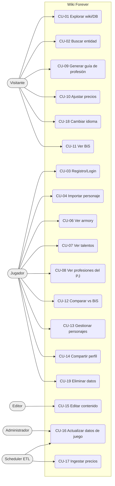

# 04 · Casos de uso

## 1. Actores

| Actor | Tipo | Descripción |
|-------|------|-------------|
| Visitante | Primario | Usuario sin sesión; consulta datos y usa la calculadora |
| Jugador | Primario | Usuario autenticado; importa y gestiona personajes |
| Editor | Primario | Jugador con rol de contribuidor de wiki (R4) |
| Administrador | Primario | Gestiona datos, ingestas y moderación |
| Addon exportador / Uploader | Secundario | Genera el archivo de datos del personaje |
| Scheduler ETL | Secundario | Ejecuta ingestas programadas |
| API Blizzard | Secundario (futuro) | Fuente oficial si se habilita para Forever |

## 2. Diagrama general

## 3. Catálogo

| ID | Caso de uso | Actor | Release | RF relacionados |
|----|-------------|-------|---------|-----------------|
| CU-01 | Explorar base de datos / wiki | Visitante, Jugador | MVP | RF-DAT-01, RF-PRO-01, RF-WIK-01, RF-GEN-02 |
| CU-02 | Buscar entidad (ítem, hechizo, receta, NPC) | Visitante | MVP | RF-DAT-01, RF-DAT-06, RF-GEN-01 |
| CU-03 | Registrarse / iniciar sesión | Visitante | R2 | RF-USR-01, RF-USR-03 |
| CU-04 | Importar personaje desde archivo del addon | Jugador | R2 | RF-CHR-01, RF-CHR-07 |
| CU-05 | Importar personaje por código | Jugador | R2 | RF-CHR-02, RF-CHR-08 |
| CU-06 | Ver armory del personaje | Jugador | R2 | RF-CHR-04 |
| CU-07 | Ver talentos y comparar con build recomendada | Jugador | R3 | RF-TAL-01…04 |
| CU-08 | Ver profesiones y recetas del personaje | Jugador | R2 | RF-CHR-04, RF-PRO-10 |
| CU-09 | **Generar guía de subida de profesión** | Visitante, Jugador | MVP | RF-PRO-01…11, RF-PRI-02 |
| CU-10 | Ajustar/sobrescribir precios | Visitante, Jugador | MVP | RF-PRI-03 |
| CU-11 | Ver listas BiS | Visitante, Jugador | R3 | RF-BIS-01…03 |
| CU-12 | **Comparar personaje vs BiS** | Jugador | R3 | RF-BIS-04…06 |
| CU-13 | Gestionar múltiples personajes y snapshots | Jugador | R2 | RF-CHR-03 |
| CU-14 | Compartir perfil público | Jugador | R2 | RF-CHR-05 |
| CU-15 | Editar contenido de wiki | Editor | R4 | RF-WIK-02…04 |
| CU-16 | **Actualizar datos del juego tras un parche** | Administrador, Scheduler | MVP | RF-DAT-02…05, RF-ADM-01 |
| CU-17 | Ingestar precios | Scheduler, Jugador | MVP/R2 | RF-PRI-01, 04, 05 |
| CU-18 | Cambiar idioma | Todos | MVP | RF-USR-02 |
| CU-19 | Eliminar personaje / cuenta y datos | Jugador | R2 | RF-CHR-06, RF-USR-04 |

## 4. Especificaciones detalladas

### CU-09 · Generar guía de subida de profesión

| Campo | Detalle |
|-------|---------|
| **Actor principal** | Visitante o Jugador |
| **Objetivo** | Obtener una ruta de recetas de costo esperado mínimo para subir de skill *A* a *B* |
| **Precondiciones** | Existe una build de datos activa y al menos una fuente de precios (o el usuario ingresa precios) |
| **Disparador** | El usuario abre la calculadora de una profesión |
| **Postcondiciones** | Se muestra la ruta, la lista de compras y el costo total con su build y la frescura de precios; la ruta puede copiarse/compartirse |

**Flujo principal**
1. El usuario elige profesión, skill inicial y skill objetivo (o, con PJ importado, se precargan).
2. Elige estrategia (más barata por defecto) y mercado (ruleset/región).
3. Indica si permite patterns de vendor, de subasta, BoP/quests y si descuenta inventario.
4. El sistema obtiene recetas, probabilidades de skill-up y precios vigentes.
5. El sistema ejecuta el optimizador (ver [05 §4](05-modelo-de-dominio-y-datos.md)).
6. El sistema muestra pasos (receta × cantidad esperada × rango de skill), costo por paso, punto de entrenamiento requerido (75/150/225) y lista de compras consolidada.
7. El usuario puede ver la explicación de cada paso y comparar con la alternativa "sin patterns".

**Flujos alternos**
- **A1 · Precios obsoletos o ausentes** (paso 4): el sistema marca los ítems afectados y pide confirmar o sobrescribir; si falta el precio de un reactivo clave, la receta se excluye con aviso.
- **A2 · Sin ruta factible** (paso 5): se informa qué requisito falta (reputación, facción, rango sin entrenar) y se sugiere relajar restricciones.
- **A3 · Pattern amortizable** (paso 5): el sistema muestra el punto de equilibrio en número de crafteos.
- **A4 · Usuario autenticado con PJ** (paso 1): se usa su skill, recetas conocidas e inventario si lo permite.

**Reglas**: RN-01, RN-02, RN-04, RN-05, RN-07, RN-08.
**Criterios de aceptación** (muestra):
- *Dado* skill 1→300 de Leatherworking con precios frescos, *cuando* se calcula, *entonces* se devuelve una ruta con costo total, pasos contiguos sin huecos de skill y cantidades > 0.
- *Dado* un precio con edad > umbral, *entonces* aparece marcado como obsoleto.
- *Dado* "solo trainer", *entonces* ninguna receta de pattern comprable aparece en la ruta.

### CU-04 · Importar personaje desde archivo del addon

| Campo | Detalle |
|-------|---------|
| **Actor principal** | Jugador autenticado |
| **Objetivo** | Cargar equipo, talentos, profesiones y reputaciones de un personaje real |
| **Precondiciones** | Sesión iniciada; el jugador tiene instalado un addon exportador y ha salido del juego o hecho `/reload` |
| **Postcondiciones** | Se crea/actualiza `Character` y se guarda un `CharacterSnapshot` inmutable |

**Flujo principal**
1. El jugador abre "Importar personaje" y ve instrucciones (ruta de `SavedVariables` y addon compatible).
2. Selecciona el archivo `.lua` (o arrastra y suelta).
3. El cliente lo **parsea localmente** a un objeto JSON con un parser de tablas Lua (sin evaluar código).
4. El cliente valida con esquema Zod y muestra una vista previa por personaje detectado.
5. El jugador elige qué personajes importar y su visibilidad.
6. El servidor revalida (nunca confía en el cliente), resuelve IDs contra la build de datos y guarda el snapshot.
7. Se redirige al armory del personaje.

**Flujos alternos**
- **A1 · Formato desconocido / versión no soportada**: mensaje con la versión detectada y lista de formatos soportados.
- **A2 · Archivo malicioso o enorme**: se rechaza por límites de tamaño/profundidad; no se guarda nada.
- **A3 · Ítems de una build desconocida**: se importan marcando entidades "sin resolver" y aviso de datos desactualizados.
- **A4 · Personaje ya existente**: se crea un nuevo snapshot y se conserva el histórico.

**Reglas**: RN-06, RN-09. **RNF**: RNF-06, RNF-07.

### CU-12 · Comparar personaje vs BiS

| Campo | Detalle |
|-------|---------|
| **Actor principal** | Jugador |
| **Objetivo** | Saber qué ítems/talentos separan al personaje del óptimo y qué mejorar primero |
| **Precondiciones** | Personaje importado; existe lista BiS y perfil de stat weights para su spec/fase |

**Flujo principal**
1. El jugador elige personaje, spec y fase/objetivo (p. ej. raid vs dungeons).
2. El sistema calcula el score del equipo actual y el del BiS bajo el mismo perfil de pesos.
3. Muestra diferencia por slot, score total y porcentaje del óptimo.
4. Prioriza upgrades por (mejora de score ÷ esfuerzo) y muestra fuente de obtención.
5. El jugador puede editar pesos y ver el recálculo inmediato.

**Alternos**: spec sin lista BiS (se ofrece perfil genérico); ítems sin datos de stats (se excluyen con aviso); restricciones 2H/dual wield (se evalúan combinaciones válidas).
**Reglas**: RN-01. **Aceptación**: el score del BiS ≥ score de cualquier equipo válido del catálogo para el perfil (test de propiedad).

### CU-16 · Actualizar datos del juego tras un parche

| Campo | Detalle |
|-------|---------|
| **Actor principal** | Administrador / Scheduler |
| **Objetivo** | Incorporar una nueva build de datos sin romper lo existente |
| **Precondiciones** | Datos extraídos del cliente disponibles en el formato esperado |

**Flujo principal**
1. Se registra la nueva build (`GameBuild`) en estado `staging`.
2. El ETL transforma y **valida** entidades (Zod) y chequea integridad referencial.
3. Se genera un reporte de diferencias contra la build activa (altas/bajas/cambios).
4. El administrador revisa el reporte y **promueve** la build a `active`.
5. Se invalidan cachés y se regeneran artefactos estáticos precomputados.

**Alternos**: validación falla → build queda en `failed` con reporte; la activa no cambia. **Rollback**: reactivar la build anterior.
**Reglas**: RN-01, RNF-09.

### CU-17 · Ingestar precios

**Actor**: Scheduler / Jugador (carga de escaneo). **Flujo**: recibe observaciones (fuente, mercado, ítem, precio mínimo/mediana, cantidad, timestamp) → valida → descarta outliers por regla estadística → guarda `PriceSnapshot` → recalcula agregados (mediana, percentiles, edad). **Alterno**: fuente no disponible → se conserva el último dato y se marca su edad.

## 5. Casos de uso breves (resto)

| ID | Flujo resumido | Alternos relevantes |
|----|----------------|---------------------|
| CU-01 | El usuario navega por clase/profesión/zona/tipo y abre la ficha de la entidad con su fuente de obtención | Entidad inexistente en la build → 404 con búsqueda sugerida |
| CU-02 | Atajo ⌘/Ctrl+K → escribe → resultados agrupados por tipo → selecciona | Sin resultados → sugerencias; búsqueda tolerante a errores |
| CU-03 | Registro/login → sesión → preferencias | Credenciales inválidas; cuenta bloqueada por abuso |
| CU-05 | El jugador pega un código → se decodifica y valida → misma ruta que CU-04 (pasos 4–7) | Código corrupto o expirado |
| CU-06 | Abre armory → ve equipo, stats, nivel → tooltips de ítems | Ítem sin resolver → muestra ID con aviso |
| CU-07 | Selecciona PJ → ve árbol con puntos asignados → compara con build recomendada | Spec sin build recomendada |
| CU-08 | Ve profesiones, skill y recetas conocidas; enlaza a CU-09 con datos precargados | Sin datos de profesión en el snapshot |
| CU-10 | Edita precio de un ítem → se recalcula la ruta → se guarda en perfil o localmente | Precio inválido (negativo/no numérico) |
| CU-11 | Elige clase/spec/fase → ve lista por slot con fuentes y score | Lista en revisión/no publicada |
| CU-13 | Lista personajes → renombra, archiva, actualiza, ve historial | Límite de snapshots por personaje |
| CU-14 | Cambia visibilidad → obtiene URL pública → puede revocarla | Personaje con ítems sin resolver |
| CU-15 | Crea borrador MDX → previsualiza → envía a revisión → publica | Conflicto de edición → merge asistido |
| CU-18 | Cambia idioma → persiste preferencia → rutas localizadas | Clave sin traducir → fallback a EN con registro |
| CU-19 | Solicita borrado → confirma → se eliminan personajes, snapshots y cuenta | Reautenticación requerida |
