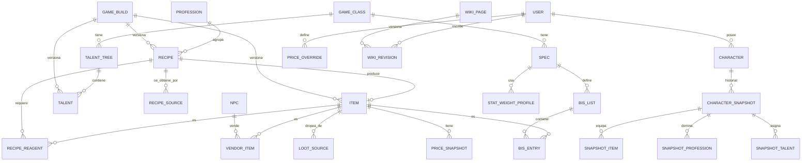

# 05 · Modelo de dominio y datos

## 1. Principios de modelado

1. **Datos de juego inmutables por build**: lo que cambia con un parche se versiona, no se sobrescribe (`build_id` en toda tabla de juego).
2. **Snapshots inmutables de personajes**: un refresco crea un snapshot nuevo; el histórico es gratis y permite ver progreso.
3. **Dinero en cobre, entero** (RN-02).
4. **Procedencia explícita**: cada dato de juego, precio o contenido registra su fuente.
5. **Separar lo estático de lo dinámico**: datos de juego → artefactos precomputados (CDN); precios, usuarios y personajes → base de datos viva.
6. **Datos importados = no confiables** hasta pasar esquema (RN-09).

## 2. Diagrama entidad–relación (núcleo)



## 3. Entidades principales

| Entidad | Campos clave (propuesta) | Notas |
|---------|--------------------------|-------|
| `game_build` | `id`, `client_build`, `label`, `status` (`staging/active/failed/archived`), `extracted_at` | Una sola `active` |
| `item` | `id` (ID del juego), `build_id`, `name_i18n`, `quality`, `slot`, `armor_type`, `stats` (jsonb normalizado), `vendor_sell_cobre`, `binds`, `unique` | Clave compuesta `(id, build_id)` |
| `recipe` | `id`, `build_id`, `profession_id`, `min_skill`, `orange`, `yellow`, `green`, `gray`, `produces_item_id`, `produces_qty`, `rank_required`, `faction` | Umbrales de color derivados de datos del cliente |
| `recipe_reagent` | `recipe_id`, `item_id`, `qty` | |
| `recipe_source` | `recipe_id`, `type` (`trainer/vendor/auction/drop/quest/reputation`), `ref_id`, `cost_cobre`, `binds` | Un pattern puede tener varias fuentes |
| `price_snapshot` | `item_id`, `market`, `source`, `observed_at`, `min_cobre`, `median_cobre`, `qty` | `market` = ruleset + región (+ reino si aplica; ver [07](07-fuentes-de-datos-y-viabilidad.md)) |
| `price_override` | `user_id`, `item_id`, `market`, `price_cobre` | Local si el usuario es anónimo |
| `character` | `id`, `user_id`, `name`, `surname`, `class_id`, `race_id`, `visibility`, `ruleset` | Forever exige nombre y apellido |
| `character_snapshot` | `id`, `character_id`, `taken_at`, `build_id`, `source_format`, `source_version`, `raw` (jsonb) | `raw` solo tras validación |
| `snapshot_item` | `snapshot_id`, `slot`, `item_id`, `enchant`, `gems` | |
| `bis_list` / `bis_entry` | `spec_id`, `phase`, `role`, `slot`, `item_id`, `rank`, `note` | |
| `stat_weight_profile` | `spec_id`, `name`, `weights` (jsonb), `owner` (`system/user`) | Perfiles de usuario editables |
| `wiki_page` / `wiki_revision` | `slug`, `class_id`, `status`, `body_mdx`, `author_id`, `created_at` | Historial completo |

## 4. Algoritmos centrales

### 4.1 Optimizador de subida de profesiones

**Entrada**: profesión, skill `A`→`B`, conjunto de recetas disponibles, precios, estrategia, restricciones (patterns permitidos, rangos).
**Salida**: lista ordenada de pasos `{receta, desde, hasta, crafts esperados, costo}` y lista de compras.

**Modelo**
- Probabilidad de skill-up `p(s, r)` según el color de la receta a skill `s` (naranja = 1; amarillo/verde decrecientes; gris = 0). Los umbrales provienen de los datos; los valores de `p` para amarillo/verde son **configurables** y se calibran en el spike SP-4.
- Costo por punto: `c(r, s) = (Σ reactivos − valor de recuperación del producto) / p(s, r)`.
- Costo de reactivo = `min(precio de compra, costo de craftearlo)` (recursivo, RF-PRO-08).
- Costo fijo `F_r` de un pattern (compra en vendor/subasta) pagado una vez si se usa.
- Segmento `(r, s1→s2)` es válido si `p(s, r) > 0` para todo `s` del segmento y se cumplen los requisitos de rango/reputación. Costo: `F_r + Σ c(r, s)`.

**Resolución**: camino más corto en un **DAG** cuyos nodos son niveles de skill y cuyas aristas son segmentos válidos. Complejidad ≈ O(S · R · S) sin podar; con poda por dominancia (solo recetas naranja/amarillas en `s`) es viable en el cliente.

**Supuesto documentado**: cada receta se usa en **un único segmento contiguo** (evita contar dos veces el costo fijo). Se valida contra fuerza bruta en pruebas con instancias pequeñas.

**Estrategias** = cambios de función objetivo: *más barata* (oro), *menos crafteos* (número de acciones), *sin BoP*, *solo vendor*.

```ts
// Contrato indicativo (packages/optimizer)
export interface Recipe {
  id: number; minSkill: number;
  colors: { orange: number; yellow: number; green: number; gray: number };
  reagents: { itemId: number; qty: number }[];
  rankRequired: 'apprentice' | 'journeyman' | 'expert' | 'artisan';
  sources: RecipeSource[]; // trainer | vendor | auction | drop | quest | reputation
}
export interface PlanInput {
  from: number; to: number; recipes: Recipe[];
  priceOf(itemId: number): { cobre: number; ageHours: number } | undefined;
  strategy: 'cheapest' | 'fewest-crafts' | 'no-bop' | 'vendor-only';
  allowPatterns: { vendor: boolean; auction: boolean; quest: boolean };
}
export interface PlanStep {
  recipeId: number; fromSkill: number; toSkill: number;
  expectedCrafts: number; costCobre: number; trainRankBefore?: string;
}
export function planProfession(input: PlanInput): { steps: PlanStep[]; totalCobre: number; shopping: ShoppingLine[] };
```

**Propiedades a probar** (property-based): costo total = suma de pasos; sin huecos de skill; nunca elegir receta gris; monotonía (bajar el precio de un reactivo nunca sube el costo total); equivalencia con fuerza bruta en instancias pequeñas.

### 4.2 Score de ítem y comparación con BiS

- `score(item, w) = Σ_stat w[stat] · item.stats[stat] + Σ efectos_especiales · w_efecto`.
- Mejor ítem por slot = argmax del score entre candidatos válidos (clase, armadura, nivel, fase).
- Casos con interacción se resuelven por **enumeración acotada**: pares de anillos/abalorios (únicos), 2H vs dual wield, bonos de set.
- `gap = Σ_slot (score_BiS − score_actual)`; prioridad de upgrade = `Δscore / esfuerzo`, con esfuerzo derivado de la fuente (dificultad de drop, costo en oro, reputación).
- Los **pesos son datos**, no código: perfiles versionados y editables.

### 4.3 Agregación de precios

Mediana y percentiles sobre ventana móvil por `(item, market)`; descarte de outliers (p. ej. IQR); edad = ahora − `observed_at`; prioridad de fuentes: oficial > escaneo reciente > comunitario > override manual (este último siempre gana para el usuario que lo definió).
