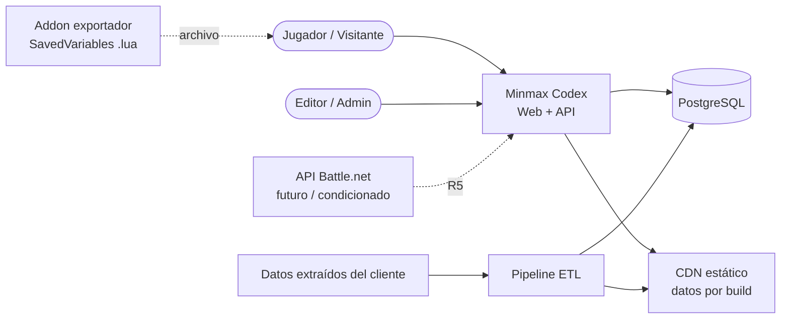
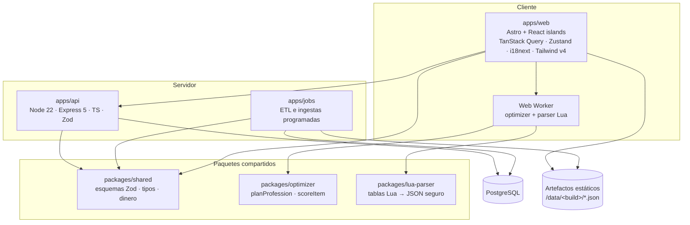

# 06 · Arquitectura y decisiones (ADRs)

## 1. Direccionadores arquitectónicos

| Direccionador | Implicación |
|---------------|-------------|
| Datos de juego de lectura masiva, cambian por parche | **Static-first**: precomputar por build y servir desde CDN |
| Optimizador intensivo pero determinista | Paquete TS puro, ejecutable en cliente (Web Worker) y servidor |
| Sin API oficial de personajes | Ingesta por archivos de addon; parser seguro; formato versionado |
| SEO para miles de entidades y guías | Renderizado estático/SSG para contenido público |
| Un solo desarrollador, tiers gratuitos | Pocas piezas móviles, monorepo, CI fuerte, despliegue simple |
| Calidad como diferenciador | Testing, accesibilidad y tipado estricto desde el día 1 |

## 2. Vista de contexto



## 3. Vista de contenedores



## 4. Estructura del monorepo (pnpm workspaces + Turborepo)

```
minmax-codex/
├─ apps/
│  ├─ web/            # Astro + React 19 (islas), Tailwind v4, i18next
│  ├─ api/            # Express 5 + Zod + capa de datos
│  ├─ jobs/           # ETL, agregación de precios, generación de estáticos
│  └─ addon/          # Exportador Lua mínimo (WoW Forever)
├─ packages/
│  ├─ shared/         # Esquemas Zod, tipos, utilidades de dinero (cobre)
│  ├─ optimizer/      # Lógica pura: planProfession, scoreItem, gap
│  ├─ lua-parser/     # Parser de tablas Lua sin evaluación
│  ├─ ui/             # Sistema de diseño accesible (tokens + componentes)
│  └─ config/         # tsconfig, eslint, vitest, playwright compartidos
├─ data/              # Fixtures y "golden files" para pruebas del ETL
├─ docs/              # Esta documentación + ADRs
└─ turbo.json · pnpm-workspace.yaml
```

## 5. Stack tecnológico

| Capa | Elección | Justificación |
|------|----------|---------------|
| Lenguaje | **TypeScript estricto** en todo el repo | Tipos compartidos front/back/ETL; stack dominado |
| UI | **React 19** (componentes orientados a componentes), Tailwind v4 con tokens | Dominio del autor; sistema de diseño reutilizable |
| Contenido público | **Astro** (SSG) con islas React | SEO de miles de páginas + interactividad donde importa (ADR-004) |
| Estado servidor | **TanStack Query** | Caché, reintentos, invalidación |
| Ruteo app interactiva | **TanStack Router** | Ya usado en el portafolio; rutas tipadas |
| Estado cliente | **Zustand** | Parámetros de calculadora, preferencias |
| i18n | **i18next** | ES/EN; ya usado |
| API | **Node 22 + Express 5** | Stack del autor |
| Validación | **Zod** | Contratos únicos entre capas |
| BD | **PostgreSQL** | Relacional con jsonb para datos semiestructurados |
| Acceso a datos | **Drizzle ORM** + drizzle-kit | Tipado inferido del esquema y SQL visible (ADR-007) |
| Pruebas | **Vitest** (+ fast-check), **Playwright**, **axe-core** | Estándar del autor; accesibilidad automática |
| CI/CD | **GitHub Actions** | Ya usado |
| Hosting | Vercel (web + API), GitHub Actions programadas (ETL/jobs), PostgreSQL gestionado (Supabase) | Costo ≈ 0 y poca operación (ADR-008) |
| Autenticación | **Supabase Auth** (JWT verificado en Express) | Evita implementar credenciales propias (ADR-009) |
| Monorepo | **pnpm + Turborepo** | Ya usado; caché de tareas |

## 6. Diseño de API (borrador)

REST + JSON con contrato en Zod → OpenAPI generado. Versionada (`/v1`).

| Método | Ruta | Descripción | Auth |
|--------|------|-------------|------|
| GET | `/v1/builds/active` | Build activa y metadatos | No |
| GET | `/v1/prices?market=&itemIds=` | Agregados de precio con edad | No |
| POST | `/v1/prices/observations` | Subir escaneo (R2) | Sí |
| POST | `/v1/characters/import` | Importar snapshot validado | Sí |
| GET | `/v1/characters` · `/v1/characters/:id` | Listar/ver (propios o públicos) | Parcial |
| PATCH | `/v1/characters/:id/visibility` | Privado/público | Sí |
| DELETE | `/v1/characters/:id` | Borrado completo | Sí |
| GET | `/v1/bis?spec=&phase=` | Lista BiS | No |
| POST/PATCH | `/v1/wiki/pages` | Edición editorial (R4) | Editor |
| POST | `/v1/admin/builds` · `/promote` | Ingesta y promoción de build | Admin |

Los datos estáticos de juego (recetas, ítems, hechizos) **no pasan por la API**: se sirven como JSON versionado por build desde CDN y se cachean con `immutable`.

## 7. Flujos clave

```mermaid
sequenceDiagram
  actor J as Jugador
  participant W as Web (Worker)
  participant A as API
  participant D as PostgreSQL
  J->>W: Selecciona SavedVariables.lua
  W->>W: lua-parser → JSON (sin evaluar código)
  W->>W: Valida con Zod + vista previa
  J->>W: Confirma personajes y visibilidad
  W->>A: POST /v1/characters/import
  A->>A: Revalida (nunca confía en cliente) + límites
  A->>D: Resuelve IDs vs build activa; guarda snapshot
  A-->>W: 201 + id de personaje
  W-->>J: Redirige al armory
```

## 8. Seguridad (resumen)

- Parser Lua propio **sin `eval`**: solo literales de tabla; límites de tamaño, profundidad y número de claves.
- Validación Zod en cada frontera; *rate limiting* y límites de subida; cabeceras seguras (CSP estricta).
- Autorización por propietario en personajes; privacidad por defecto; borrado completo.
- Sin secretos en el cliente; variables por entorno; Dependabot y `pnpm audit` en CI.
- Si se integra Battle.net OAuth en el futuro: PKCE, *scopes* mínimos y tokens cifrados.

## 9. Observabilidad y operación

Logs estructurados con `requestId`; métricas de ETL (filas, rechazos, duración); alertas de ingesta fallida; página de estado simple con build activa y frescura de precios.

## 10. Registro de decisiones (ADRs)

> La evaluación de alternativas, consecuencias y condiciones de revisión de cada ADR está en [11 · Justificación de decisiones de ingeniería](11-justificacion-de-decisiones-de-ingenieria.md).

| ID | Decisión | Estado |
|----|----------|--------|
| ADR-001 | Monorepo pnpm + Turborepo | **Aceptada** |
| ADR-002 | Conectar personajes por **exportación de addon + importación de archivo**; integración oficial condicionada | **Aceptada** |
| ADR-003 | `optimizer` como paquete puro compartido; ejecución en Web Worker | **Aceptada** |
| ADR-004 | Astro (SSG) + islas React para contenido público; app interactiva en React | **Aceptada — condicionada a SP-6** |
| ADR-005 | Datos de juego versionados por build y servidos como artefactos estáticos | **Aceptada** |
| ADR-006 | Dinero como entero en cobre | **Aceptada** (RN-02) |
| ADR-007 | Acceso a datos: **Drizzle ORM** | **Aceptada** |
| ADR-008 | Hosting: Vercel (web + API) + GitHub Actions (jobs) + PostgreSQL gestionado | **Aceptada** (verificar Express en Vercel en Fase 0) |
| ADR-009 | Autenticación: **Supabase Auth**; Battle.net OAuth diferido a R5 | **Aceptada** |
| ADR-010 | Optimizador: camino más corto en DAG de segmentos | **Aceptada** |
| ADR-011 | Parser Lua propio sin evaluación | **Aceptada** |
| ADR-012 | Retención y agregación de precios (30 días crudos + agregados) | **Aceptada** (ajustada por ADR-013) |
| ADR-013 | API-first con addon como complemento (reemplaza parcialmente a ADR-002 y ajusta ADR-009 y ADR-012) | **Aceptada** (2026-11-18) |

### ADR-002 (detalle)

- **Contexto**: no hay API pública confirmada de personajes para Forever; el ecosistema usa addons que escriben `SavedVariables`.
- **Decisión**: el producto define un **formato de exportación versionado** (`schemaVersion`), ofrece un addon mínimo y acepta formatos de terceros mediante adaptadores. La importación se hace con archivo/código; un uploader de escritorio es posterior.
- **Consecuencias**: (+) no depende de Blizzard, privacidad (parseo local), testeable; (−) fricción de usuario, datos tan frescos como el último `/reload` o salida del juego, mantenimiento de adaptadores.
- **Revisión**: cuando exista namespace de Forever en la API de Battle.net (ver [07](07-fuentes-de-datos-y-viabilidad.md)).

### ADR-004 (detalle)

- **Opciones**: (a) SPA Vite + prerender; (b) **Astro + islas React**; (c) Next.js.
- **Criterio decisivo**: miles de páginas de entidades y guías que deben ser indexables, con herramientas interactivas puntuales. React se mantiene como tecnología principal; Astro se justifica por SSG y por ser ya el stack del portafolio del autor.
- **Riesgo**: dos modelos de ruteo (Astro para contenido, TanStack Router para la app interactiva). Mitigación: spike SP-6 midiendo SEO, LCP y complejidad antes de fijar.
