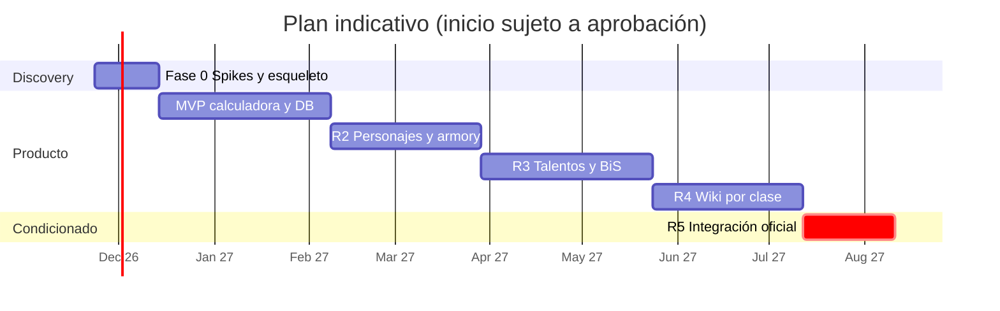

# 09 · Roadmap y backlog

> Estimaciones **orientativas** para un desarrollador a tiempo parcial (≈10–15 h/semana). Se recalibran al cerrar cada fase. Flujo de trabajo: **descubrimiento → aprobación → implementación en incrementos pequeños**.

## 1. Fases

| Fase | Contenido | Duración est. | Gate de salida |
|------|-----------|---------------|----------------|
| **0 · Discovery** | Spikes SP-1…SP-7, ADRs abiertas, esqueleto del monorepo y CI | 2–3 semanas | Documentación aprobada; fuente de datos y de precios decididas |
| **MVP** | Base de datos navegable + **calculadora de profesiones** + i18n + despliegue | 7–9 semanas | Ruta 1→300 válida para ≥ 2 profesiones; RNF-01/03 cumplidos |
| **R2** | Cuentas, importación de personajes, armory, profesiones del PJ, ingesta de precios por addon | 6–8 semanas | Importar PJ real y generar guía desde su skill |
| **R3** | Talentos, BiS, comparación vs BiS, panel admin | 7–9 semanas | Gap vs BiS explicable para ≥ 3 clases |
| **R4** | Wiki por clase, editor, revisiones, changelog de datos | 6–8 semanas | 9 clases con página base publicada |
| **R5** | Integración oficial / uploader (condicionado a API de Blizzard) | Variable | Según disponibilidad |

## 2. Épicas

| Épica | Descripción | Release | RF |
|-------|-------------|---------|----|
| E0 | Fundaciones: monorepo, CI, sistema de diseño, i18n | Fase 0/MVP | RNF-11…14, RF-USR-02 |
| E1 | Pipeline ETL y versionado por build | MVP | RF-DAT-02/03 |
| E2 | Base de datos navegable (ítems, recetas, hechizos) | MVP | RF-DAT-01/06, RF-GEN-01/02 |
| E3 | Calculadora de profesiones | MVP | RF-PRO-01…09 |
| E4 | Precios (modelo, frescura, override) | MVP/R2 | RF-PRI-01…04 |
| E5 | Cuentas y privacidad | R2 | RF-USR-01/03/04 |
| E6 | Importación y armory de personajes | R2 | RF-CHR-01…07 |
| E7 | Talentos | R3 | RF-TAL-01…03 |
| E8 | BiS y comparación | R3 | RF-BIS-01…06 |
| E9 | Wiki por clase y editorial | R4 | RF-WIK-01…04 |
| E10 | Operación y administración | R3+ | RF-ADM-01, RNF-13 |

## 3. Backlog inicial (Fase 0 y primeros sprints)

Tamaño: S (≤ 1 día), M (2–3 días), L (≈ 1 semana).

### Fase 0
| ID | Historia | Tam. | Criterio de aceptación |
|----|----------|------|------------------------|
| H-001 | Como dev, quiero el monorepo con pnpm + Turborepo, TS estricto, lint y Vitest | M | `pnpm i && pnpm test` pasa en limpio y en CI |
| H-002 | Como dev, quiero un workflow de CI (lint, tipos, tests, build) | S | PR sin verde no se puede fusionar |
| H-003 | Como dev, quiero ejecutar **SP-1** (dataset de 1–2 profesiones) | L | Informe con método, formato y verificación de 20 recetas |
| H-004 | Como dev, quiero ejecutar **SP-2** (formato de exportación y parser) | L | Archivo real parseado y validado con Zod |
| H-005 | Como dev, quiero decidir la fuente de precios (**SP-3**) | M | Decisión documentada en ADR |
| H-006 | Como dev, quiero validar el modelo de skill-up (**SP-4**) | M | `p(s,r)` documentada con evidencia |
| H-007 | Como dev, quiero comparar Astro+islas vs SPA (**SP-6**) | M | Tabla de LCP/SEO/complejidad y ADR-004 cerrado |
| H-008 | Como dev, quiero checklist legal (**SP-7**) | S | Documento aprobado |

### MVP (primeros sprints)
| ID | Historia | Tam. | Criterio de aceptación |
|----|----------|------|------------------------|
| H-010 | Esquemas Zod de entidades de juego (`item`, `recipe`, `reagent`, `source`) | M | Validan el dataset de SP-1; rechazan datos corruptos |
| H-011 | ETL idempotente con `game_build` y estados `staging/active` | L | Reejecutar no duplica; reporte de diferencias |
| H-012 | Artefactos estáticos por build servidos con caché `immutable` | M | URL incluye build; cabeceras verificadas |
| H-013 | Paquete `optimizer`: probabilidad de skill-up y costo por punto | M | Tests unitarios por color; tipos exportados |
| H-014 | `planProfession` con DAG de segmentos y costo fijo de patterns | L | Property tests + equivalencia con fuerza bruta |
| H-015 | Estrategias (más barata, menos crafteos, sin BoP, solo vendor) | M | Cada una produce resultados distintos en casos de prueba |
| H-016 | UI calculadora: formulario, resultado por pasos, lista de compras copiable | L | Accesible (axe sin violaciones críticas), responsive |
| H-017 | Modelo y UI de precios con edad, obsoleto y override | M | Precio > umbral se marca; override recalcula la ruta |
| H-018 | Fichas de ítem/receta con tooltips y fuentes de obtención | M | Enlaces cruzados; URLs canónicas |
| H-019 | Búsqueda global ⌘/Ctrl+K | M | Resultados agrupados por tipo; navegable con teclado |
| H-020 | i18n ES/EN completo y detección de claves faltantes en CI | S | CI falla si falta una clave |
| H-021 | E2E Playwright del flujo CU-09 + Lighthouse CI | M | Flujo feliz y alterno A1 cubiertos |

### R2 (adelanto)
| ID | Historia | Tam. | Criterio de aceptación |
|----|----------|------|------------------------|
| H-030 | Paquete `lua-parser` sin evaluación y con límites | M | Fuzz y archivos maliciosos rechazados |
| H-031 | Importación de personaje (UI + API + snapshot) | L | CU-04 completo con flujos A1–A4 |
| H-032 | Armory (equipo, stats, profesiones) | L | Ítems resueltos con tooltips |
| H-033 | Privacidad y borrado completo | M | E2E de borrado; RNF-07 |

## 4. Definition of Ready (historia lista para sprint)
- Valor y RF/CU enlazados; criterios de aceptación verificables.
- Dependencias de datos identificadas; diseño de UI/API esbozado si aplica.
- Tamaño ≤ L; si es mayor, se divide.

## 5. Criterios de release por fase
- Todas las historias del alcance cumplen DoD ([10](10-calidad-y-devops.md)).
- RNF aplicables medidos (rendimiento, a11y, seguridad).
- Documentación y ADRs actualizados; registro de riesgos revisado.
- Demo + aprobación explícita para pasar a la siguiente fase.
